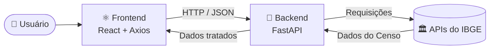

<div align="center">

# 🌎 Sistema Populacional IBGE

### Consulta, evolução e comparação de dados demográficos dos municípios brasileiros — com foco na **Bahia**

<p>
  
  
  
  
  
</p>

<p>
  <a href="#-sobre-o-projeto">Sobre</a> •
  <a href="#-funcionalidades">Funcionalidades</a> •
  <a href="#-arquitetura">Arquitetura</a> •
  <a href="#-tecnologias">Tecnologias</a> •
  <a href="#-como-executar">Como executar</a> •
  <a href="#-equipe">Equipe</a>
</p>

</div>

---

## 📖 Sobre o projeto

O **Sistema Populacional IBGE** é uma aplicação web distribuída que consome as APIs públicas do **IBGE (Instituto Brasileiro de Geografia e Estatística)** para transformar dados do Censo em informação visual, clara e comparável.

Com ele é possível explorar o ranking dos municípios mais populosos, acompanhar o crescimento de qualquer cidade entre **1991 e 2022** e comparar duas cidades lado a lado — tudo em uma interface moderna com efeito *glassmorphism*.

> 🎓 **Projeto acadêmico** desenvolvido para a unidade curricular **Sistemas Distribuídos e Mobile**.

---

## ✨ Funcionalidades

| Recurso | Descrição |
| :--- | :--- |
| 🏆 **Top 10 municípios** | Ranking interativo das cidades mais populosas da Bahia, com suporte aos demais estados. |
| 📈 **Evolução do Censo** | Gráfico de linha com o crescimento populacional de 1991 a 2022 para qualquer município do Brasil. |
| ⚖️ **Comparador demográfico** | Compara duas cidades, exibindo a diferença absoluta e a razão de proporção entre elas. |
| 🎨 **Interface inovadora** | Design em *glassmorphism*, cartões flutuantes, paleta equilibrada e mapas minimalistas do Brasil e da Bahia. |

<!-- Substitua pelos prints reais do sistema -->
<!--
## 🖼️ Screenshots

| Home | Evolução | Comparador |
| :---: | :---: | :---: |
|  |  |  |
-->

---

## 🏗️ Arquitetura

O projeto segue o modelo **monorepo**, com separação clara entre a API e a interface. O backend atua como camada intermediária: consulta o IBGE, trata os dados e entrega ao frontend apenas o necessário.



### 📁 Estrutura de pastas

```text
projeto-populacao-ibge/
├── backend/                  # API REST em Python com FastAPI
│   ├── main.py               # Ponto de entrada da aplicação e configuração de CORS
│   ├── controllers/          # Endpoints HTTP da API
│   ├── services/             # Regras de negócio e integração com o IBGE
│   ├── schemas/              # Validação de tipos com Pydantic
│   └── models/               # Modelos internos de domínio
│
└── frontend/                 # Interface web em React
    └── src/
        ├── components/       # Componentes visuais (cards, gráficos)
        ├── pages/            # Páginas da aplicação (Home, Comparador)
        └── services/         # Cliente HTTP (Axios) conectado à API
```

---

## 🛠️ Tecnologias

**Backend**
- [Python 3.10+](https://www.python.org/)
- [FastAPI](https://fastapi.tiangolo.com/) — framework da API REST
- [Pydantic](https://docs.pydantic.dev/) — validação e serialização de dados
- [Uvicorn](https://www.uvicorn.org/) — servidor ASGI

**Frontend**
- [React 18+](https://react.dev/)
- [Axios](https://axios-http.com/) — cliente HTTP

**Fonte de dados**
- [APIs de Dados do IBGE](https://servicodados.ibge.gov.br/api/docs) — Censo Demográfico

---

## 🚀 Como executar

### 📋 Pré-requisitos

- [Python 3.10+](https://www.python.org/downloads/)
- [Node.js 18+](https://nodejs.org/) e npm
- [Git](https://git-scm.com/)

### 1️⃣ Clonar o repositório

```bash
git clone <URL_DO_REPOSITORIO_NO_GITHUB>
cd projeto-populacao-ibge
```

### 2️⃣ Backend (FastAPI)

```bash
cd backend

# Crie e ative um ambiente virtual
python -m venv venv

# Linux / macOS
source venv/bin/activate
# Windows
venv\Scripts\activate

# Instale as dependências
pip install -r requirements.txt

# Inicie o servidor
uvicorn main:app --reload
```

✅ API disponível em **http://localhost:8000**
📚 Documentação interativa (Swagger) em **http://localhost:8000/docs**

### 3️⃣ Frontend (React)

Em outro terminal:

```bash
cd frontend

# Instale as dependências
npm install

# Inicie a aplicação
npm run dev
```

✅ Interface disponível em **http://localhost:5173** *(a porta pode variar conforme a configuração do projeto)*

> 💡 Mantenha o backend rodando enquanto usa o frontend — a interface depende da API para buscar os dados.

---


# 👥 Nossa Equipe
 
### Os desenvolvedores por trás do projeto
 
<br/>
<table>
  <tr>
    <td align="center" width="200">
      <br/><br/>
      <h3>Welterson<br/>Gabriel</h3>
      <sub></sub>
    </td>
    <td align="center" width="200">
      <br/><br/>
      <h3>Guilherme<br/>Silva</h3>
      <sub></sub>
    </td>
    <td align="center" width="200">
      <br/><br/>
      <h3>Eric<br/>Junqueira</h3>
      <sub></sub>
    </td>
    <td align="center" width="200">
      <br/><br/>
      <h3>Gustavo<br/>Gomes</h3>
      <sub></sub>
    </td>
    <td align="center" width="200">
      <br/><br/>
      <h3>Gabriel<br/>Fernando</h3>
      <sub></sub>
    </td>
  </tr>
</table>
<br/>

 
<br/>

## 🎓 Orientação Acadêmica
 

<br/><br/>
 

<br/><br/>
 
> 👨‍🏫 *Agradecemos ao professor **Joilson Amorim Moreira** pela orientação e apoio durante todo o desenvolvimento deste projeto.*
 
</div>
---
 

---

## 📄 Licença

Este projeto foi desenvolvido para fins acadêmicos. Os dados utilizados pertencem ao **IBGE** e são de acesso público.

<div align="center">

Dados: [IBGE](https://www.ibge.gov.br/)

</div>


